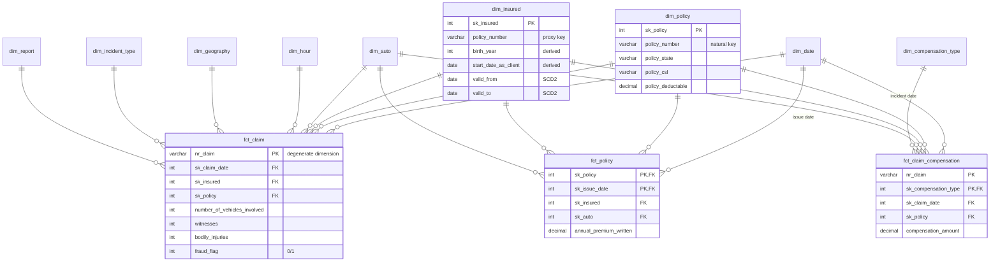

# Insurance Dimensional Model

A Kimball-style star schema for an auto insurance company, built from a single flat claims file. The model separates two business processes (claims and policy issuance), declares an explicit grain for every fact table, and links both processes through conformed dimensions to support metrics such as the **loss ratio**.

**Status:** design complete (DBML). Implementation in Microsoft Fabric is planned.

## Business questions supported

- What is the loss ratio (compensation ÷ premium) by policy state?
- How much is paid per compensation type (bodily injury, property damage, vehicle), by incident state, severity or period?
- What is the fraud rate by incident type, insured profile or vehicle?
- How do claims vary by hour of day, day of week, insured age band or customer tenure?

## Source data

Kaggle **Auto Insurance Claims** dataset (`insurance_claims.csv`): about 1,000 rows and 40 columns in a single flat table (policy, insured, incident, vehicle, compensation amounts and a fraud flag). The project turns this One Big Table into a star schema.

## Data model



The diagram shows key columns only. Both claim facts share the same eight dimensions; `dim_compensation_type` links to the line fact alone. The full model, with every column and note, is in [`model/insurance_star_schema.dbml`](model/insurance_star_schema.dbml) (paste it into [dbdiagram.io](https://dbdiagram.io) to view).

### Fact tables

| Fact | Type | Grain | Measures |
| --- | --- | --- | --- |
| `fct_claim` | Transactional (header) | 1 row per incident | vehicles involved, witnesses, bodily injuries, fraud flag |
| `fct_claim_compensation` | Transactional (line) | 1 row per incident × compensation type | compensation amount |
| `fct_policy` | Transactional | 1 row per policy issuance | written premium |

### Dimensions

| Dimension | Scope | Notes |
| --- | --- | --- |
| `dim_date` | Conformed | Role-playing: incident date and issue date |
| `dim_policy` | Conformed | Links claims and premium |
| `dim_insured` | Conformed | SCD Type 2 by design |
| `dim_auto` | Conformed | One row per car model |
| `dim_hour` | Claims | Hour and day period |
| `dim_geography` | Claims | City grain |
| `dim_incident_type` | Claims | Type, collision type, severity |
| `dim_report` | Claims | Junk dimension of report flags |
| `dim_compensation_type` | Claim line | Bodily injury, property damage, vehicle |

## Key design decisions

- **Two processes, three facts.** Claims and policy issuance have their own dates and measures, so they are modeled separately. Claims use a header/line pair: incident-level measures stay in the header to avoid fan-out.
- **Atomic grain via unpivot.** The three compensation columns become rows of `fct_claim_compensation`, with one measure and a compensation type dimension. `total_claim_amount` is derived, not stored.
- **Conformed `dim_policy`.** Enables drill-across between claims and premium for the loss ratio.
- **Generated claim key.** The source has no claim ID; `nr_claim` combines policy, incident date and hour.
- **Written premium, not earned.** The source has no renewal or cancellation history, so `fct_policy` is transactional. An earned-premium periodic snapshot is the planned evolution.
- **Stable attributes for time-variant data.** Birth year and customer start date are derived so each fact computes age and tenure at its own event date.
- **Surrogate keys everywhere.** Natural keys are kept as attributes; every dimension has an unknown member (`-1`).

The reasoning behind each decision, the alternatives considered and a glossary are in the [design document](docs/design.md).

## Example: loss ratio by policy state

Two facts are combined by aggregating each through the conformed dimension, then joining the results:

```sql
WITH claims AS (
  SELECT p.policy_state, SUM(c.compensation_amount) AS total_compensation
  FROM fct_claim_compensation c JOIN dim_policy p ON p.sk_policy = c.sk_policy
  GROUP BY p.policy_state
),
premium AS (
  SELECT p.policy_state, SUM(f.annual_premium_written) AS total_premium
  FROM fct_policy f JOIN dim_policy p ON p.sk_policy = f.sk_policy
  GROUP BY p.policy_state
)
SELECT c.policy_state, c.total_compensation / pr.total_premium AS loss_ratio
FROM claims c JOIN premium pr ON pr.policy_state = c.policy_state;
```

## Assumptions and limitations

- No insured ID in the source: `policy_number` is used as a proxy (one insured per policy).
- Insured attributes are a single snapshot at incident date; SCD2 is in the design but holds one version per insured.
- Birth year is estimated from age at incident (±1 year).
- Every policy in the dataset has a claim, so the loss ratio is far above a real portfolio.
- Insured profile columns show signs of synthetic data.

## Repository structure

```
├── README.md
├── model/
│   └── insurance_star_schema.dbml   # full model (dbdiagram.io)
└── docs/
    └── design.md                    # design decisions, assumptions, glossary
```

## Roadmap

- [x] Dimensional model design (DBML)
- [ ] Data profiling to validate assumptions
- [ ] Implementation in Microsoft Fabric
- [ ] Earned-premium periodic snapshot (with coverage history)
